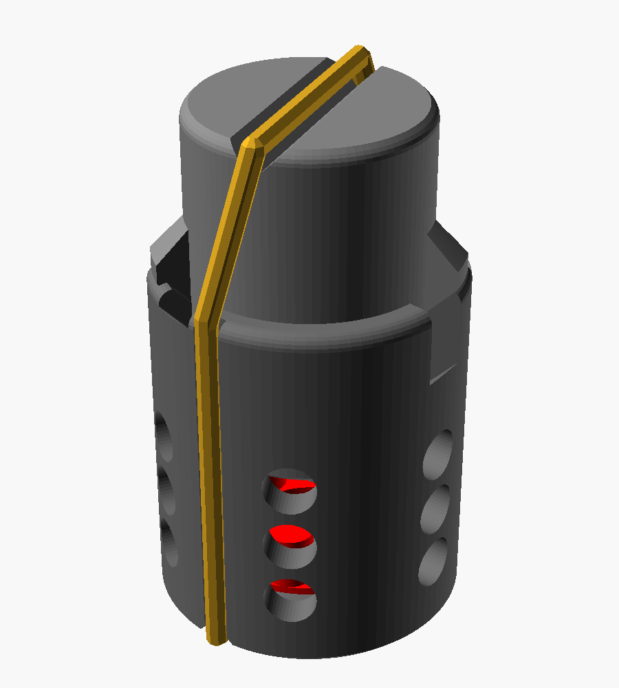

# Wollivan's Airsoft Grenade

Why does every airsoft grenade require 8 billion parts to be printed or for you to own a small workshop with every possible size of m nut and random cotter pins?

NO MORE!

## How tho?

A plunger and a tube that gets squeezed by a rubber band. Nuff said (but to say a little more, there is 3 positions)

- **Safe:** cannae go nowhere
- **Cock:** ready to POP
- **Fire:** My favourite poem: BOOM! BOOM! BOOM!

## Printing

- Print either:
  - `stl/plunger_plate.stl`
  - or `stl/plunger_body.stl` and `stl/plunger_piston.stl` separately
- You shouldn't need supports (but I'm here for you anyway)
- Use 100% infill on the plunger for weight and strength
- Print `stl/plunger_gauge.stl` first to check your caps fit the pins if you didn't buy the ones they keep under the till at Smyths

## Rubber band

Not included.

## Changing it so it actually works

All settings are in `plunger_common.scad`. Set the cap measurements there, and use `plunger_preview.scad` to view it safe, cocked or fired. Renders are in `renders/`.

## Status

it don't work
